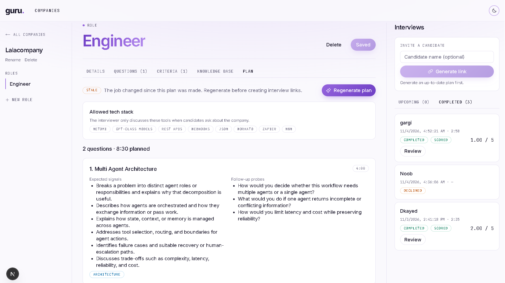
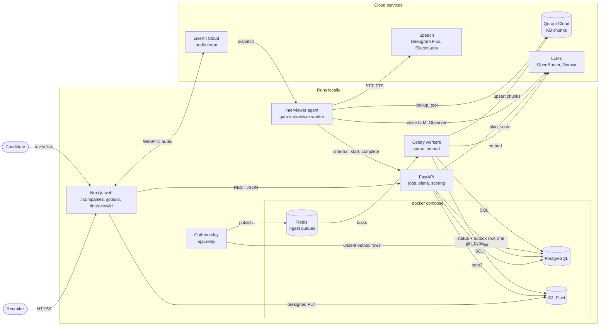
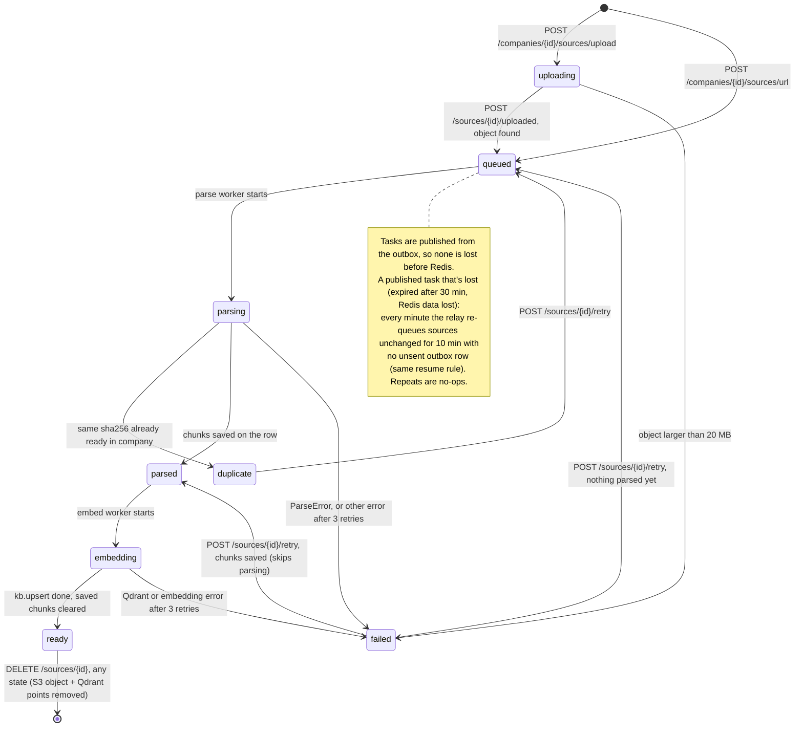
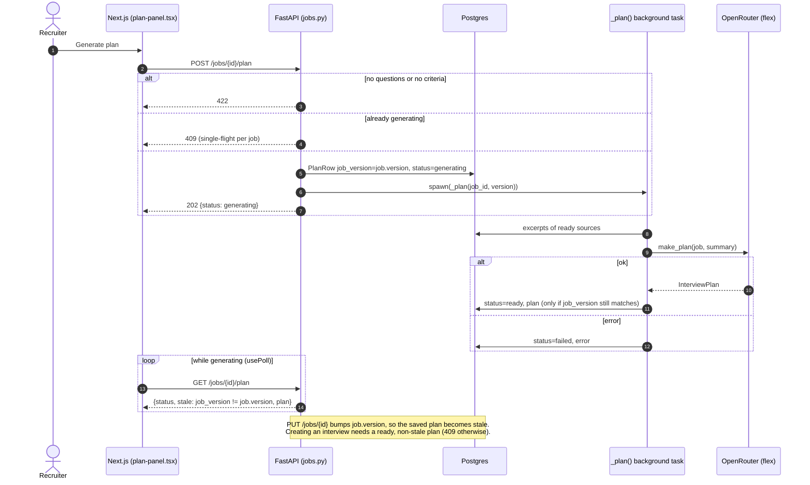
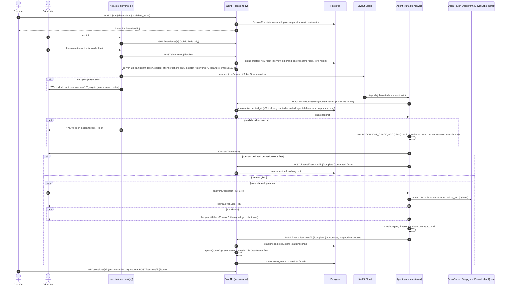
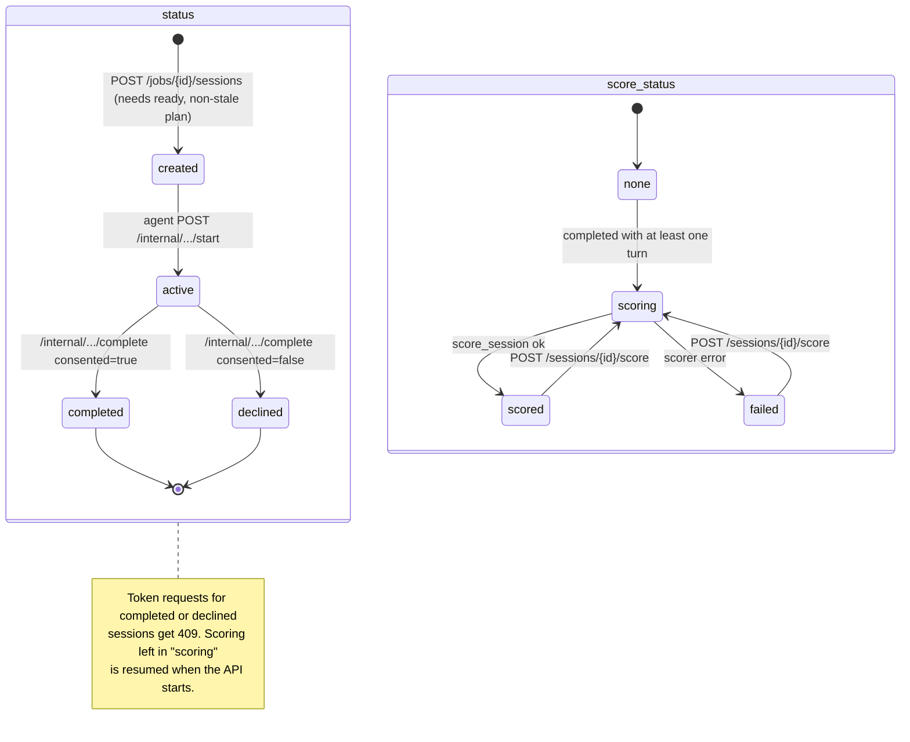
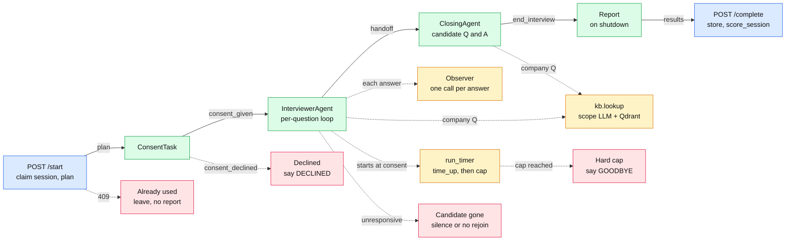
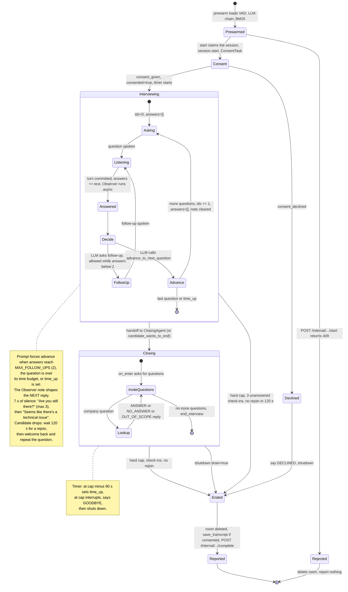
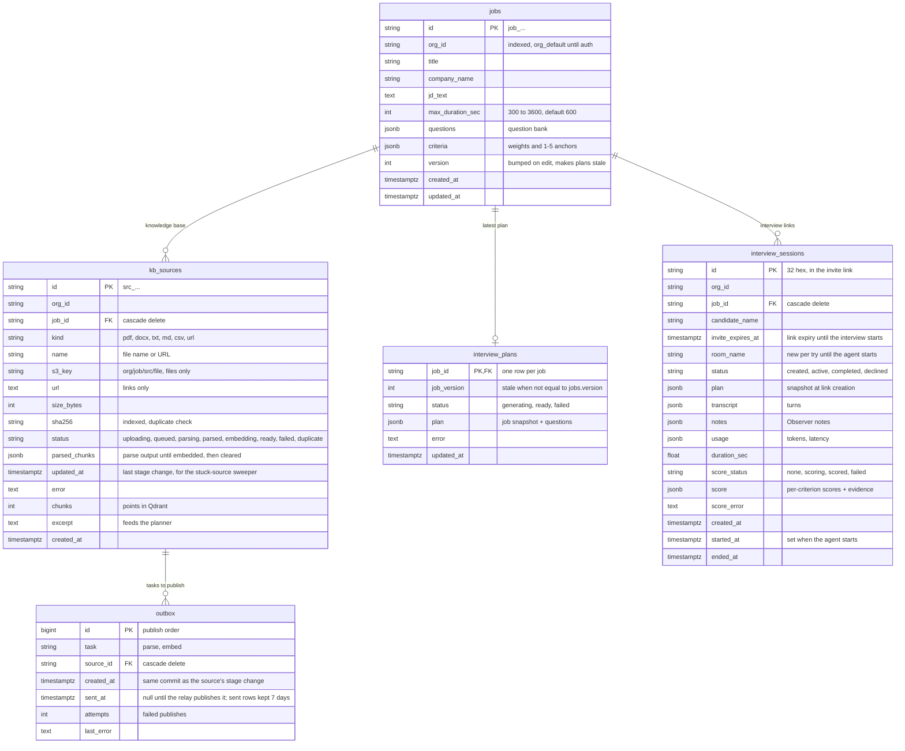

# Guru

An AI voice interviewer. A recruiter sets up a job (questions, scoring criteria, company
knowledge base), Guru plans the interview, and a candidate joins an audio-only call from an invite
link. A LiveKit voice agent runs the interview; afterwards the transcript is scored per criterion
for the recruiter to review. Scores are advisory and need a human decision.



| Folder | What | Stack |
|---|---|---|
| [`web/`](web/) | Recruiter dashboard and the candidate interview page | Next.js 15, TypeScript, LiveKit Agents UI |
| [`backend/`](backend/) | REST API: jobs, knowledge-base upload and ingestion, plans, invite links, scoring | FastAPI, SQLAlchemy (async), Alembic |
| [`agent/`](agent/) | The voice interviewer, plus the planner, scorer and knowledge-base code (`guru` package) | LiveKit Agents (Python) |
| [`deploy/`](deploy/) | Local infrastructure | Docker Compose: Postgres 18, Floci (S3), Redis |
| [`docs/`](docs/) | Diagram sources (Mermaid `.mmd`, Archify JSON) | |

Background design and decisions: [PLAN.md](PLAN.md).

## Contents
- [Architecture](#architecture)
- [Flows](#flows)
- [Database schema](#database-schema)
- [Getting started](#getting-started)
- [Troubleshooting](#troubleshooting)
- [Tests](#tests)
- [Diagram sources](#diagram-sources)

## Architecture



| Part | Responsibility |
|---|---|
| **Web** | Recruiter screens (job editor, knowledge base, plan preview, interview links, session review) and the candidate page (consent, mic check, audio room). Calls only the API; it never holds LiveKit keys. |
| **API** | Source of truth in Postgres. Issues presigned upload URLs and LiveKit tokens, queues knowledge-base ingestion for the workers, runs plan generation and scoring in-process, and exposes `/internal/*` to the agent behind a service token. |
| **Agent** | One process per interview. Claims the session (`POST /internal/sessions/{id}/start`), runs consent, questions and follow-ups, and the closing Q&A, then posts the transcript and Observer notes back (`/complete`). |
| **Workers** | Celery over Redis, one worker per stage: the parse worker fetches, dedupes and parses a source and saves its chunks; the embed worker embeds them into Qdrant. Each source's stage lives in Postgres, so a retry resumes after the last stage that succeeded. |
| **Outbox relay** | Every stage change that needs a task commits an `outbox` row with it; the relay publishes unsent rows to Redis every second, so no task is lost between Postgres and Redis. Delivery is at least once and every stage skips work already done. It also re-queues sources whose published task was lost, and deletes sent rows after 7 days. |
| **Floci** | Local S3 emulator; uploads go browser → S3 directly. Swap for AWS S3 by changing `S3_ENDPOINT` and keys. |
| **Qdrant** | Company knowledge base (one collection, `kb_chunks`, filtered by `org_id` and `kb_id` = the company id), dense + BM25 vectors. Never holds candidate data. |
| **LLMs** | The live interviewer uses Gemini (`gemini-3.5-flash-lite`) first, falling back to OpenRouter; it reached the first token faster in `agent/evals/voice_llm_eval.py`. Every other text call (planner, Observer, scope check, scorer) uses OpenRouter (`openai/gpt-6-luna`) first with Gemini as fallback. Gemini also does embeddings. |

Interactive version with pan, zoom and guided views: open
[docs/architecture/system.html](docs/architecture/system.html) in a browser (after cloning).

## Flows

### End-to-end, as a user

1. **Recruiter** creates a job: details, question bank (form or CSV import), scoring criteria.
2. Adds knowledge-base sources (PDF, DOCX, TXT, MD, CSV or a web link) and waits for `ready`.
3. Generates the interview plan and reviews which questions were picked or skipped.
4. Creates an interview link and sends it to the candidate.
5. **Candidate** opens `/interview/<id>`, ticks the consent boxes, passes the mic check, and talks to Guru.
6. The session becomes `completed` and is scored in the background.
7. **Recruiter** opens the session: per-criterion scores with evidence that links to transcript turns.

### Knowledge-base upload and ingestion

```mermaid
sequenceDiagram
  autonumber
  actor R as Recruiter
  participant W as Next.js (kb-panel.tsx)
  participant A as FastAPI (jobs.py)
  participant S3 as S3 (Floci)
  participant DB as Postgres (kb_sources, outbox)
  participant RL as Outbox relay (relay.py)
  participant RQ as Redis (parse, embed queues)
  participant PW as Parse worker (Celery)
  participant EW as Embed worker (Celery)
  participant Q as Qdrant (kb.py)

  alt File (PDF, DOCX, TXT, MD, CSV)
    R->>W: drop file
    W->>A: POST /companies/{id}/sources/upload {filename, content_type, size_bytes}
    A->>A: limits (20 MB, 50 sources), SourceRow status=uploading
    A-->>W: {source, upload_url, headers} (presign_put)
    W->>S3: PUT upload_url (file bytes, browser to storage)
    alt PUT failed
      W->>A: DELETE /sources/{id}
    else PUT ok
      W->>A: POST /sources/{id}/uploaded
      A->>S3: size_of(key)
      alt larger than 20 MB
        A->>S3: delete(key)
        A-->>W: status=failed
      else
        A->>DB: status=queued + outbox(parse), one commit
      end
    end
  else Website link
    R->>W: paste URL
    W->>A: POST /companies/{id}/sources/url {url}
    A->>DB: status=queued + outbox(parse), one commit
  end

  loop every second
    RL->>DB: unsent outbox rows (FOR UPDATE SKIP LOCKED)
    RL->>RQ: send_task(..., expires=30 min)
    RL->>DB: sent_at=now
  end
  RQ->>PW: parse_source(id)
  PW->>PW: status=parsing
  alt kind == url
    PW->>PW: fetch_page(url): SSRF check per hop, robots.txt, 5 MB, 10 s
  else file
    PW->>S3: get_bytes(key)
  end
  PW->>PW: sha256, same content already ready in this company?
  alt duplicate
    PW->>PW: status=duplicate
  else new content
    PW->>PW: parse(kind, data, name) (ParseError -> status=failed)
    PW->>DB: status=parsed, parsed_chunks, excerpt + outbox(embed), one commit
    RL->>RQ: embed_source(id) (next poll)
    RQ->>EW: embed_source(id)
    EW->>EW: status=embedding
    EW->>Q: delete_source(org, source_id)
    EW->>Q: upsert(company, name, chunks, source_id) (Gemini embeddings, batches of 64)
    EW->>EW: status=ready, chunks; parsed_chunks cleared
  end
  Note over PW,EW: other errors: retried 3 times (10, 20, 40 s), then status=failed with saved progress kept
  loop every few seconds (usePoll)
    W->>A: GET /companies/{id}/sources
  end
```

Source statuses:



### Plan generation



### Live interview



One attempt per interview: until an agent has started, every try gets a new LiveKit room (a token
only dispatches the agent when it creates the room). Once the agent starts, a dropped candidate can
rejoin the same room for 2 minutes; after that the interview ends and the link stops working.

Interview and scoring statuses:



### Inside the agent



Blue: backend API. Green: voice session. Amber: helpers. Red: forced exits; every exit except
"Already used" still runs Report.

Interactive version with notes: [docs/architecture/agents.html](docs/architecture/agents.html) (after
cloning). The same flow as states, with timings and follow-up rules:



## Database schema



Questions, criteria, plans, transcripts and scores are JSONB because they are always read and
written whole. Outside Postgres:

| Store | Key / layout | Holds |
|---|---|---|
| S3 bucket `guru-uploads` | `{org_id}/{job_id}/{source_id}/{file}` | Uploaded knowledge-base files |
| Qdrant collection `kb_chunks` | payload `org_id`, `job_id`, `source_id`, `source`, `text` | Embedded chunks; deleted per source |
| `agent/out/{session_id}.json` | one file per consented interview | Local backup of the results the agent posts |

## Getting started

### Prerequisites

- **Docker** with the Compose plugin (`docker compose version` works)
- **[uv](https://docs.astral.sh/uv/)** (installs Python 3.12+ for you)
- **Node.js 24** and npm
- Accounts and API keys: [LiveKit Cloud](https://cloud.livekit.io), [Deepgram](https://deepgram.com),
  [ElevenLabs](https://elevenlabs.io), [OpenRouter](https://openrouter.ai),
  [Google AI Studio](https://aistudio.google.com) (Gemini), [Qdrant Cloud](https://cloud.qdrant.io)

Ports used: `3000` web, `8080` API, `5432` Postgres, `4566` Floci, `6379` Redis.

### 1. Start Postgres, S3 and Redis

From the repo root (naming the services starts only the infrastructure; a bare `up` would also start
the app containers, see "Run everything in Docker" below):

```bash
docker compose -f deploy/docker-compose.yml up -d postgres floci redis
```

```bash
docker compose -f deploy/docker-compose.yml ps
```

All three services should show `running` (Postgres also `healthy`). Data lives in Docker volumes, so it
survives restarts.

### 2. Add your keys

```bash
cp agent/.env.example agent/.env
```

Fill in `agent/.env`: LiveKit URL, key and secret, Deepgram, ElevenLabs, OpenRouter, Google, and
Qdrant. Then generate the token the agent uses to call the API and paste it into
`GURU_SERVICE_TOKEN`:

```bash
python -c "import secrets; print(secrets.token_urlsafe(32))"
```

The backend reads `agent/.env` too, so keys live in one place. Never commit `.env` files.

### Run everything in Docker (instead of steps 3 to 5)

With `agent/.env` filled in (step 2) and `backend/.env` copied from its example, one command builds
and starts the database, S3, Redis, API, outbox relay, both ingest workers, the agent and the web
app:

```bash
cp backend/.env.example backend/.env
```

```bash
docker compose -f deploy/docker-compose.yml up -d --build
```

```bash
docker compose -f deploy/docker-compose.yml logs -f api agent
```

- Open http://localhost:3000 (API docs: http://localhost:8080/docs). The API runs the migrations on
  start; the other services wait until it's healthy.
- Images contain the code, so rerun `up -d --build` after a change. Only the changed images rebuild.
- Each part has its own `Dockerfile` in `agent/`, `backend/` and `web/`. The backend builds from the
  repo root (it installs `../agent`), so its ignore rules live in `backend/Dockerfile.dockerignore`;
  Docker ignores a `backend/.dockerignore` for that build, so keep the name or `.env` files get
  copied into the image.
- `.env` files are passed in at run time and never copied into an image. Inside the network the
  services use container addresses (`postgres`, `floci`, `redis`, `api`), set in the compose file.
- The agent runs in production mode (`start`) limited to 2 CPUs, so it keeps 2 warm processes
  (about 250 MB each) for interviews.
- The web app's API address is fixed at build time (`http://localhost:8080`).
- Don't also run the servers from steps 3 to 5: ports 8080 and 3000 would clash.

### 3. Run the API

```bash
cd backend
cp .env.example .env
uv sync
uv run alembic upgrade head
uv run fastapi dev app/main.py --port 8080
```

`backend/.env` already matches the Compose services. API docs: http://localhost:8080/docs. On start
the API creates the S3 bucket and the Qdrant collection if they're missing.

### 3b. Run the outbox relay and the ingest workers (three new terminals)

The relay publishes queued work from Postgres to Redis; two Celery workers parse and embed it:

```bash
cd backend
uv run python -m app.relay
```

```bash
cd backend
uv run celery -A app.worker worker -Q parse -n parse@%h --pool=solo --loglevel=info
```

```bash
cd backend
uv run celery -A app.worker worker -Q embed -n embed@%h --pool=solo --loglevel=info
```

`--pool=solo` is needed on Windows (one task at a time per worker); on Linux drop it to use the
default prefork pool.

Redis keys and TTLs:

| Key | TTL |
|---|---|
| Task messages in `parse`, `embed` | 30 min per message (Celery `expires`): an older task is discarded unrecorded, and the relay re-queues its source |
| `unacked` (taken, not finished) | 15 min `visibility_timeout`: a crashed worker's task goes back on the queue |
| The queues themselves, `_kombu.binding*` | None, on purpose: an expiring queue deletes pending tasks; kombu keeps bindings TTL-free |

Redis runs with `appendonly yes` (queued tasks survive a restart) and `noeviction`.

Interview links expire after `INVITE_TTL_MIN` minutes (default 10) unless the interview has started;
**Renew link** restarts the clock.

### 4. Run the agent (new terminal)

```bash
cd agent
uv sync
uv run python -m guru.interviewer dev
```

Wait for `registered worker` in the output. Keep the API running: the agent fetches each
interview's plan from it and posts results back. Logs also go to `agent/logs/guru.txt`.

To talk to the agent without the web app (uses the sample plan in `agent/fixtures/`):

```bash
uv run python -m guru.interviewer console
```

### 5. Run the web app (new terminal)

```bash
cd web
cp .env.example .env.local
npm install
npm run dev
```

Open http://localhost:3000 and follow [End-to-end, as a user](#end-to-end-as-a-user).

### Stopping

Stop each app with `Ctrl+C`. Stop the containers:

```bash
docker compose -f deploy/docker-compose.yml down
```

To also delete all local data (database and uploads):

```bash
docker compose -f deploy/docker-compose.yml down -v
```

## Troubleshooting

| Symptom | Cause and fix |
|---|---|
| Candidate page: "We couldn't start your interview" | No agent joined within about 20 s. Start the agent (step 4) and wait for `registered worker`, then click **Try again**. |
| Agent joins and leaves at once, log says `Interview already started or ended` | That interview link was already used. Create a new link. |
| Browser calls `localhost:8000` or gets CORS errors | The web app was built before `NEXT_PUBLIC_API_URL` changed. `NEXT_PUBLIC_*` values are baked in at build time: restart `npm run dev`, or rerun `npm run build` before `npm start`. |
| Source stuck on `queued` or `parsed` | The relay or a worker (step 3b) isn't running. Start it; nothing is lost, waiting work is picked up when it starts. If a published task itself was lost, the relay re-queues the source after 10 minutes (`INGEST_STUCK_MIN`). |
| Relay logs `Outbox publish failed` | Redis is down. Start it (step 1); the relay retries every second, in order, and records the error on the `outbox` row. |
| `alembic upgrade head` can't connect | Postgres isn't up. Check `docker compose -f deploy/docker-compose.yml ps`. |
| `warning: VIRTUAL_ENV=... does not match the project environment` | Another project's virtualenv is active in that shell. Harmless; run `deactivate` to silence it. |
| Console errors `publisher data channel ... closed unexpectedly` after the goodbye | LiveKit closing the connection when the agent deletes the room. Expected noise. |

## Tests

```bash
cd agent
uv run python -m pytest -q
```

```bash
cd backend
uv run python -m pytest -q
```

```bash
cd web
npx tsc --noEmit
npm run lint
```

## Diagram sources

The diagrams above are copies of these Mermaid files: edit the source, then paste it into the
matching README block. The two architecture diagrams also have an interactive Archify version; keep
both in step.

| Diagram | Source |
|---|---|
| Architecture | [docs/architecture/system.mmd](docs/architecture/system.mmd); interactive: [system.architecture.json](docs/architecture/system.architecture.json) → [system.html](docs/architecture/system.html) |
| Flows | [docs/flows/](docs/flows/) |
| Agent architecture | [docs/architecture/agents.mmd](docs/architecture/agents.mmd); interactive: [agents.workflow.json](docs/architecture/agents.workflow.json) → [agents.html](docs/architecture/agents.html) |
| Agent states | [docs/agent/states.mmd](docs/agent/states.mmd) |
| Database schema | [docs/database.mmd](docs/database.mmd) |

How to regenerate the Archify diagrams: [docs/architecture/UPDATE_PROMPT.md](docs/architecture/UPDATE_PROMPT.md).
